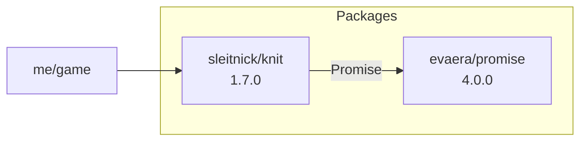

# crater

> **If you can support author:** [Place](https://www.roblox.com/games/104318394065422/donating)

A project manager for Luau and Roblox, written in C# on .NET 10.

One `crater.json` describes the whole project: the packages it uses, the tools it needs (Rojo, luau-lsp, StyLua and others), its scripts and how it is published. crater creates the project from a template, installs packages from the crater registry, Wally, pesde, Forest and Ember, pins the same tool versions for the whole team, runs Rojo with a live reinstall and checks the project with `doctor` and `audit`.

It started as a package manager like Wally or pesde, borrows ideas from Cargo and npm, and keeps its registry in a plain GitHub repository where anyone can publish through a pull request.

**The project**

- `crater init --template game|library|plugin` creates a ready Rojo project, `crater import` converts `wally.toml` and `pesde.toml`
- Pinned tools: `crater tool add rojo luau-lsp` puts the versions into `crater.json`, everyone who clones the project gets the same ones. The list of known tools lives in [`tools.json`](tools.json) and grows without a release
- `crater run` for project scripts, `crater dev` for Rojo plus a reinstall every time `crater.json` changes
- `crater doctor` checks the setup, `crater audit` checks the packages: deprecated versions, scripts that run in your game, licenses, backdoor patterns, updates
- Workspaces, [monorepositories](#monorepositories) you pick parts from, [interfaces](#interfaces) with `crater find-interface`, `crater bump` for versions, `crater self-update`, Tab completion for PowerShell, bash, zsh and fish

**The packages**

- Three dependency groups (`import_client`, `import_server`, `import_develop`), each installed into a folder you name
- Short version syntax: `scope/name^`, `=1.2.3`, `+1.2.3`, `^1.2.3`, `~1.2.3`
- Aliases (`Promise:evaera/promise^4`), local folders (`@path:../lib`) and git repositories (`@git+https://...#v1`)
- Every package is installed once per folder, and `overrides` force one version for the whole tree
- Link files re-export `export type` declarations, so luau-lsp sees package types
- Lock file with sha256 checks, parallel downloads, a summary of what changed
- Installs from the crater registry, Wally, pesde, Forest and Ember, also mixed in one project
- `outdated`, interactive `update -i`, `why`, `graph`, `search`, `info`, `patch`, `unused`, `size`, `licenses`
- Changelogs and deprecation messages from package authors, shown on install, update and the website
- Optional updates of `.luaurc` aliases and the luau-lsp definition files in VS Code
- Optional confirmation before every action that changes files, colored output

**The registry**

- A git registry with pull request checks that scan every package for backdoors
- A static package website with search, popular packages, versions and changelogs
- Private registries for teams, on a private GitHub repository

---

## Contents

1. [Installation](#installation)
2. [Quick start](#quick-start)
3. [crater.json](#craterjson)
4. [crater.settings.json](#cratersettingsjson) and [.crater-declare](#crater-declare)
5. [Dependency syntax](#dependency-syntax)
6. [Aliases](#aliases)
7. [One copy per package and overrides](#one-copy-per-package-and-overrides)
8. [Local and git dependencies](#local-and-git-dependencies)
9. [Workspaces](#workspaces), [Monorepositories](#monorepositories), [Interfaces](#interfaces)
10. [Realms and transitive dependencies](#realms-and-transitive-dependencies)
11. [What gets installed](#what-gets-installed)
12. [Editor integration](#editor-integration)
13. [crater.lock](#craterlock)
14. [Everyday commands](#everyday-commands)
15. [Patching packages](#patching-packages)
16. [Tools](#tools)
17. [Live development](#live-development)
18. [Package reports](#package-reports)
19. [The registry](#the-registry)
20. [Publishing](#publishing)
21. [The package website](#the-package-website)
22. [Releasing crater](#releasing-crater)
23. [Command reference](#command-reference)
24. [Environment variables](#environment-variables)
25. [Limitations](#limitations)
26. [Source layout](#source-layout)

---

## Installation

One script for every system. It detects Windows, Linux or macOS and the processor (x64 or arm64) by itself.

**Windows** (PowerShell):

```powershell
irm https://raw.githubusercontent.com/TheExeDEV/crater/main/installers/install | iex
```

**Linux, macOS, Git Bash:**

```bash
curl -fsSL https://raw.githubusercontent.com/TheExeDEV/crater/main/installers/install | sh
```

Both lines run the same file. It downloads the latest release into `%LOCALAPPDATA%\crater\bin` (Windows) or `~/.crater/bin` and adds that folder to `PATH`: the user `PATH` on Windows, `~/.bashrc`, `~/.zshrc`, `~/.profile` and fish on Linux and macOS. Open a new terminal and run `crater --version`. Update later with `crater self-update`; once a day crater checks for a new version and tells you after a command finishes.

Options, set before the command: `CRATER_VERSION=0.1.0` installs a specific version, `CRATER_INSTALL_DIR` changes the folder, `CRATER_NO_PATH=1` leaves `PATH` alone. In PowerShell: `$env:CRATER_VERSION = "0.1.0"`.

**Manually:** download `crater-<platform>` from [the latest release](https://github.com/TheExeDEV/crater/releases/latest), rename it to `crater` (or `crater.exe`) and put it on your `PATH`.

### Tab completion

```bash
crater completion
```

Run it once, open a new terminal, type `crater ` and press Tab. It completes commands, flags, subcommands like `crater tool add`, your dependencies after `remove`, `update`, `why` and `patch`, and your scripts after `run`. It picks your shell by itself: PowerShell (both 5 and 7 profiles) on Windows, otherwise bash, zsh or fish from `$SHELL`. Name it to choose: `crater completion install zsh`. Running it again replaces the old block instead of adding a second one. `crater completion powershell` (or `bash`, `zsh`, `fish`) only prints the script, if you want to add it to your profile yourself.

### Uninstall

Also one script for every system:

```powershell
irm https://raw.githubusercontent.com/TheExeDEV/crater/main/installers/uninstall | iex
```

```bash
curl -fsSL https://raw.githubusercontent.com/TheExeDEV/crater/main/installers/uninstall | sh
```

It removes the crater executable and the `PATH` entries the installer added. Other files in the install folder stay. The download cache and settings are kept; to remove them too:

```powershell
$env:CRATER_PURGE = 1; irm https://raw.githubusercontent.com/TheExeDEV/crater/main/installers/uninstall | iex
```

```bash
curl -fsSL https://raw.githubusercontent.com/TheExeDEV/crater/main/installers/uninstall | sh -s -- --purge
```

Installed as a .NET tool instead? Run `dotnet tool uninstall -g crater`.


The default registry is [TheExeDEV/crater-registry](https://github.com/TheExeDEV/crater-registry), browse it at [registry.crater-dev.workers.dev](https://registry.crater-dev.workers.dev/). It works without any config.

**As a .NET tool** (needs the .NET 10 SDK):

```bash
dotnet pack src/Crater -c Release -o nupkg
```

```bash
dotnet tool install -g crater --add-source ./nupkg
```

**From source:**

```bash
dotnet build src/Crater -c Release
```

```bash
dotnet src/Crater/bin/Release/net10.0/crater.dll --help
```

---

## Quick start

```bash
crater init
```

This creates `crater.json` and `crater.settings.json` with everything filled in: the package name comes from your GitHub login (after `crater login`, otherwise from your computer user name) and the folder name, `"registry": "https://github.com/TheExeDEV/crater-registry"` is already set.

To start a whole project instead of only the config, pick a template:

| Command | What you get |
|---|---|
| `crater init --template game` | `default.project.json` for a place (`ReplicatedStorage.Shared`, `ServerScriptService.Server`, `StarterPlayerScripts.Client`, the package folders), a server and a client script, a shared module, `.gitignore`. `can_publish` is `false`. |
| `crater init --template library` | `src/init.luau`, `default.project.json`, `README.md` with install instructions, `CHANGELOG.md`, `.gitignore`. Ready for `crater publish`. |
| `crater init --template plugin` | A Studio plugin script with a toolbar button, `default.project.json` for `rojo build -o plugin.rbxm`, `.gitignore`. |

Existing files are never overwritten. Add packages and install:

```bash
crater add evaera/promise^4 --client
```

```bash
crater install
```

```
» Resolving dependencies
████████████████████████ 1/1 downloading evaera/promise@4.0.0

  + evaera/promise 4.0.0  client

✓ 1 change, 1 package installed in 0.4s
```

In code:

```luau
local Promise = require(ReplicatedStorage.Packages.promise)
```

---

## crater.json

Every project and every package has a `crater.json`. `crater init` writes every field below (except `icon`), empty ones included, so you can see what exists and fill in what you need. crater keeps the fields in groups separated by empty lines and writes them in the same order every time it saves the file. The first line, `"$schema"`, points at [`schemas/crater.schema.json`](schemas/crater.schema.json): VS Code and other editors then explain every field when you hover it, suggest fields as you type and underline mistakes. `crater.settings.json` gets [its own schema](schemas/crater.settings.schema.json).

```json
{
  "$schema": "https://raw.githubusercontent.com/TheExeDEV/crater/main/schemas/crater.schema.json",

  "name": "theexedev/my-game",
  "version": "1.0.0",
  "description": "My game",
  "authors": ["TheExeDEV"],
  "license": "MIT",
  "keywords": ["game"],
  "repository": "https://github.com/TheExeDEV/my-game",

  "registry": ["crater", "team"],
  "registries": { "team": "https://github.com/MyStudio/team-registry" },
  "can_publish": true,
  "import_to": "shared",

  "path_to_main": "src/init.luau",
  "icon": "assets/icon.png",
  "path_to_definition_files": ["types/api.d.luau", "defs", "extra/*.d.luau"],
  "package_files": { "exclude": ["tests/"], "allow": ["scripts/setup.sh"] },

  "import_client": ["beta/adof+0.12.44", "Promise:evaera/promise^4", "team#mystudio/combat^1"],
  "import_server": ["dep/dependency^"],
  "import_develop": ["roblox/testez^0.4"],
  "overrides": ["evaera/promise^4.1.0"],

  "workspace": ["packages/*"],
  "scripts": { "build": "rojo build -o build.rbxl" },
  "tools": { "rojo": "rojo-rbx/rojo@7.7.1", "luau-lsp": "JohnnyMorganz/luau-lsp@1.70.1" },
  "package_scripts": { "block": false, "allow": ["sleitnick/cmdr"] },

  "monorepository-elements": {},
  "interface": false,
  "realized_interfaces": []
}
```

| Field | Description |
|---|---|
| `name` | `scope/name`, lowercase letters, digits, `_` and `-`. In a GitHub registry the scope is your GitHub login in lowercase. |
| `authors`, `description`, `license`, `keywords` | Shown by `info`, `search` and the website. |
| `version` | Three numbers, `MAJOR.MINOR.PATCH`, for example `1.0.0` (not `1.0`), optional `-prerelease`. A project that is never published can keep any value. |
| `registry` | Where dependencies without a prefix come from and where `publish` goes: a name (`crater`, `wally`, `pesde`, `forest`, `ember` or one from `registries`), a URL or a folder, or a list of them tried in order. `crater init` writes `"crater"`. See [Several registries](#several-registries) and [Registry locations](#registry-locations). |
| `repository` | Source code URL, shown on the website. |
| `registries` | Names for your own registries: with `"team": "https://github.com/MyStudio/team-registry"` you write `team#mystudio/combat^1` in dependencies and `"team"` in `registry`. `crater`, `wally`, `pesde`, `forest` and `ember` are built in. See [Several registries](#several-registries). |
| `can_publish` | `true` lets `crater publish` send the package. `crater init` sets `true`; use `false` for games that are never published. |
| `package_scripts` | `block: true` refuses packages that run scripts in your game, except the ones in `allow`. See [Packages that run scripts](#packages-that-run-scripts). The old fields `block_package_scripts` and `allow_scripts_from` still work and are combined with it. |
| `import_to` | Where the package may run: `client`, `server` or `shared`. A `server` package cannot go into `import_client` and the other way round. |
| `path_to_main` | Entry module, for example `src/init.luau`. Empty or a folder without `init.luau` makes the package a [collection of modules](#packages-without-a-main-module). |
| `icon` | Optional picture of the package for the registry website, a path inside the package like `"assets/icon.png"`: `.png`, `.jpg`, `.webp`, `.gif` or `.svg`, at most 256 KB (256x256 pixels is plenty). `crater pack` and `crater publish` check it. Without an icon (and for Wally and pesde packages, which have none) the site shows the GitHub avatar of the scope, or a neutral placeholder. |
| `path_to_definition_files` | `.d.luau` files added to VS Code settings on install. Each entry is a file, a folder (every `.d.luau` inside it) or a pattern with `*` / `**`. Empty means every `*.d.luau` in the package (up to 10). The old single-file field `path_to_definition_file` still works. |
| `import_client`, `import_server`, `import_develop` | Dependencies, see [Dependency syntax](#dependency-syntax). |
| `overrides` | Force one version (or a local or git copy) of a package for the whole tree. See [overrides](#one-copy-per-package-and-overrides). |
| `workspace` | Folders of a monorepo, see [Workspaces](#workspaces). |
| `scripts` | Commands for `crater run`. |
| `tools` | Tools pinned to the project, `owner/repo@version`, written by `crater tool add`. See [Tools](#tools). |
| `package_files` | `exclude`: extra glob patterns left out of the published archive, on top of `.gitignore` and `.craterignore`. `allow`: scripts (`.sh`, `.bat`, `.ps1`...) to keep, see [What goes into the package](#what-goes-into-the-package); programs cannot be allowed. The old fields `exclude` and `allow_files` still work and are combined with it. |
| `monorepository-elements` | The packages of a monorepository; not empty makes this package one, see [Monorepositories](#monorepositories). |
| `interface`, `realized_interfaces` | Marks the package as an interface, or lists the interfaces it implements, see [Interfaces](#interfaces). |
| `$schema` | Lets editors show the descriptions of the fields. crater ignores it. |

---

## crater.settings.json

Install settings of your project. The folder names live here and only here: crater has no built-in folder names. `crater init` writes a full file:

```json
{
  "$schema": "https://raw.githubusercontent.com/TheExeDEV/crater/main/schemas/crater.settings.schema.json",
  "client": { "path": "Packages", "alias": "" },
  "server": { "path": "ServerPackages", "alias": "" },
  "develop": { "path": "DevPackages", "alias": "" },
  "luaurc": ".luaurc",
  "vscode_definitions": true,
  "confirm": true,
  "link_style": "roblox"
}
```

| Field | Description |
|---|---|
| `client`, `server`, `develop` | Where the packages of `import_client`, `import_server` and `import_develop` go. `path` is the folder (required when the list has dependencies, nested paths work); `alias` is its name in `.luaurc`, so `"Shared"` gives `require("@Shared/promise")`, empty means the folder name (`@Packages`). A plain string, `"client": "Packages"`, sets only the folder. |
| `luaurc` | Which `.luaurc` gets an alias for every package folder on install, or `false` to leave `.luaurc` alone. If `.vscode/settings.json` already has `"luau-lsp.server.baseLuaurc"`, that file is used instead. Another file, for example `"src/config.luaurc"`, gets the aliases with paths relative to it (`"../Packages"`), and crater sets `"luau-lsp.server.baseLuaurc"` so luau-lsp uses it. |
| `vscode_definitions` | Keep `luau-lsp.types.definitionFiles` in `.vscode/settings.json` up to date with the `.d.luau` files of installed packages. |
| `confirm` | Ask before every change. `-y` skips the questions for one run. |
| `link_style` | `roblox` (default) or `string`, see [Link styles](#link-styles). |
| `self_update_repo` | Global settings only: `Owner/Repo` used by `crater self-update`. |

The long names of older crater versions are still read: `import_client_path` and `import_client_alias` (and the same for server and develop), `on_install_update_luaurc` with `luaurc_path`, `on_install_update_vscode_luau_definition_files` and `on_install_should_i_ask_your_permission_to_do_any_action`. When a file has both, the new name wins.

Settings are merged from two files, the project wins:

1. global: `%APPDATA%\crater\settings.json` (Windows) or `~/.config/crater/settings.json`
2. project: `crater.settings.json` next to `crater.json`

The registry is not a setting: it lives in `crater.json`, because it is part of the package and travels with it when published. If `registry` is empty, the registry built into crater is used.

Older projects keep working: `crater.config.json` is still read when there is no `crater.settings.json`, and the old field `repository_registry` in `crater.json` is still read when `registry` is empty. A `registry` left in a settings file is ignored with a warning.

### Confirmations

```
? Create folder Packages (4 packages: ...) [Y/n/a]
```

`Enter` or `y` does it, `n` skips it (refusing to build a package folder cancels the install), `a` says yes to everything for this run. Without a terminal the action is skipped with a warning, so use `-y` in CI.

---

## .crater-declare

`crater init` also writes `.crater-declare`, a JSON file that says crater manages this folder and tells other tools, for example package managers that migrate projects to or from crater, everything they need to read crater files without hard coding crater's rules:

```json
{
  "path_to_crater_settings": "crater.settings.json",
  "path_to_package_info": "crater.json",
  "api_version": 3,
  "features": { "dependencies": 1, "tools": 1, "scripts": 1, "workspaces": 1, "interfaces": 1, "monorepository": 2, "settings": 2, "package_rules": 3, "registry_names": 3 },
  "schemas": { "package_info": "https://.../crater.schema.json", "crater_settings": "https://.../crater.settings.schema.json" },
  "registries": { "crater": "...", "wally": "https://github.com/UpliftGames/wally-index", "pesde": "...", "forest": "...", "ember": "..." },
  "realms": { "import_client": "client", "import_server": "server", "import_develop": "develop" },
  "dependency": { "pattern": "...", "operators": { ... }, "sources": { ... }, "registry": "..." },
  "defaults": { "authors": [], "description": "", "registry": "crater", "package_scripts": { "block": false, "allow": [] }, ... },
  "path_to_lock_file": "crater.lock",
  "cli": { "json_output": ["changelog", "info", "list", "outdated", "search", "tags"] }
}
```

| Key | What it tells other tools |
|---|---|
| `path_to_package_info`, `path_to_crater_settings` | Where `crater.json` and `crater.settings.json` are. |
| `api_version` | The format of the crater files, see the table below. |
| `features` | Each feature crater files use and the format version of that feature, so a tool can support some of them and skip the rest. |
| `schemas` | JSON schemas of both files: every field, its type and what it does. |
| `registries` | The built in registry names (`crater#`, `wally#`, `pesde#`, `forest#`, `ember#`) and their addresses. Names from `registries` in `crater.json` come on top. |
| `realms` | Which dependency list installs where. |
| `dependency` | How to read a dependency string like `Promise:wally#evaera/promise^4`: a regular expression with named groups (`alias`, `registry`, `scope`, `name`, `op`, `ver`, `source`), what every version operator means, the `@path:` and `@git+` sources, and which registry a dependency without a prefix comes from. |
| `defaults` | The value of every optional `crater.json` field that sets nothing: a field equal to it behaves as if it were missing, so a tool can drop it. An empty `registry` (`""` or `[]`) also means `crater`. |
| `path_to_lock_file` | Where `crater.lock` is: the exact installed versions, their registries and sha256. |
| `cli.json_output` | Commands that print JSON with `--json`, see [JSON output](#json-output). A tool can run `crater outdated --all --json` instead of reading the registry itself. |

The file is hidden (a dot file, and marked hidden on Windows, so you only see it with "show hidden items" turned on), it stays out of published packages, and it should be committed with the project.

crater checks it on every command. When the file is missing, broken, points at files that do not exist, is out of date or describes an older API, crater says so and writes it again. New crater versions only add keys to this file and never rename or remove the old ones; when only new keys are missing, crater adds them without a message. `api_version` and `features` change when the format of crater files changes, so other tools can tell what they are reading:

| `api_version` | Format |
|---|---|
| `1` | crater 0.5.5: long names in `crater.settings.json` (`import_client_path`, `on_install_update_luaurc`...), `"monorepository": true` next to `monorepository-elements`. |
| `2` | crater 0.5.6: `crater.settings.json` uses `client`, `server`, `develop` (`path`, `alias`), `luaurc`, `vscode_definitions`, `confirm`; a package is a monorepository when `monorepository-elements` is not empty. Files in format 1 are still read. |
| `3` | crater 0.5.7: `crater.json` has `package_scripts` (`block`, `allow`) and `package_files` (`exclude`, `allow`), `registry` may name registries (`"crater"`, `"team"`), and fields come in groups. Files in formats 1 and 2 are still read. |

## Dependency syntax

```
[Alias:][registry#]scope/name<operator><version>
[Alias:]scope/name@<source>
```

| Spec | Meaning |
|---|---|
| `bebra/dbv^` or `bebra/dbv` | latest stable version |
| `bebra/zxc=1.2.3` | exactly 1.2.3 |
| `beta/adof+0.12.44` | 0.12.44 or newer |
| `a/b^1.2.3` | compatible: `>=1.2.3 <2.0.0` (for 0.x: `^0.2.3` is `<0.3.0`) |
| `a/b^1` | `>=1.0.0 <2.0.0` |
| `a/b@1.2.3` | the same as `a/b^1.2.3`, handy in the Windows terminal (see below) |
| `a/b~1.2.3` | patch updates only: `>=1.2.3 <1.3.0` |
| `Promise:evaera/promise^4` | any of the above with an [alias](#aliases) |
| `wally#sleitnick/knit^1` | from another registry, see [Several registries](#several-registries) |
| `me/lib@path:../lib` | a [local folder](#local-and-git-dependencies) |
| `me/lib@git+https://github.com/me/lib.git#v1.0.0` | a [git repository](#local-and-git-dependencies) at a tag, branch or commit |

- `=` needs a full `MAJOR.MINOR.PATCH`.
- Prereleases are picked only by `=` or by a requirement that names a prerelease of the same version.
- Names are case insensitive and stored in lowercase.
- In the Windows `cmd` terminal `^` is a special character and disappears from commands. Type `crater add a/b@1.2.3` or put the spec in quotes: `crater add "a/b^1.2.3"`. PowerShell, Git Bash and `crater.json` are not affected. If the sign gets lost, crater says so and suggests the `@` form.

---

## Aliases

The link file is named after the short package name: `beta/adof` becomes `adof.luau`. An alias picks the name yourself:

```json
"import_client": [
  "Promise:evaera/promise^4",
  "OtherPromise:other/promise^1",
  "Signal:bebra/zxc=1.2.3"
]
```

```luau
local Promise = require(ReplicatedStorage.Packages.Promise)
```

- Use it when two packages share a short name or the name is inconvenient.
- An alias starts with a letter and contains letters, digits, `_` and `-`.
- Link names must be unique per list, compared case insensitively (`Promise` and `promise` are the same file on Windows).
- Aliases work inside packages too: a package that lists `Signal:bebra/zxc^1` gets `Signal.luau` next to it.
- `crater add Alias:scope/name^` replaces an entry with the same link name. `remove` and `update` accept an alias or a full name.

When names collide crater suggests an alias:

```
✗ crater.json: dependencies evaera/promise and other/promise would both be linked as promise.
  Give one of them an alias, for example OtherPromise:other/promise^.
```

---

## One copy per package and overrides

Within one folder every package is installed **once**. If ten packages need `evaera/promise`, there is one `evaera_promise@4.0.0` folder and ten small link files pointing at it. crater picks the highest version that satisfies everybody. `crater list` marks repeats as `(shared)`:

```
Packages/ (import_client)
  x/new-user@1.0.0
  └ dep/dependency@2.0.0
  x/old-user@1.0.0
  └ dep/dependency@2.0.0 (shared)
```

When requirements cannot be satisfied together (one package needs `^1`, another `^2`), crater stops and shows who needs what:

```
✗ [client] No version of dep/dependency satisfies all requirements:
    x/old-user requires >=1.0.0 <2.0.0
    x/new-user requires >=2.0.0 <3.0.0
  Available versions: 1.0.0, 1.1.0, 2.0.0
  To use one version for every package, add "overrides": ["dep/dependency^2.0.0"] to crater.json.
```

`overrides` force one version for the whole project, in every folder:

```json
"overrides": ["dep/dependency^2.0.0"]
```

```
! x/old-user wants dep/dependency >=1.0.0 <2.0.0, using 2.0.0 from overrides
```

An override can also point to your own modified copy of a package: `"overrides": ["evaera/promise@path:../my-promise"]` replaces it everywhere in the tree.

---

## Local and git dependencies

```json
"import_client": [
  "me/mylib@path:../mylib",
  "me/gitlib@git+https://github.com/me/gitlib.git#v1.2.0"
]
```

- The folder or repository must contain a `crater.json` whose `name` matches the dependency.
- Path dependencies are packed on every install. When the files change, the summary shows `~ me/mylib 0.1.0 (contents changed)`.
- Git dependencies need `git`. The ref can be a tag, branch or commit. The commit is stored in `crater.lock`, so `install` keeps it even when the branch moves, and `crater update me/gitlib` moves to the newest commit.
- Dependencies of a local package come from its own `registry` (relative to its folder) or from your registry.
- Published packages cannot have path or git dependencies.

---

## Workspaces

A monorepo lists its packages in the root `crater.json`:

```json
{
  "name": "me/mono",
  "version": "0.0.0",
  "workspace": ["packages/*", "tools/build"]
}
```

- A dependency on another member (`"me/core^0.1.0"`) is taken from the member's folder instead of the registry, so changes are used right away.
- `crater install --workspace` installs the root and every member. `crater update --workspace` updates them all.
- `crater publish --workspace` publishes every member with `can_publish: true`, dependencies first.
- Each member keeps its own `crater.settings.json` and `crater.lock`.

## Monorepositories

A monorepository is a package that only points at other packages, so people can pick the parts they need. A package with a non-empty `monorepository-elements` is one:

```json
{
  "name": "studio/kit",
  "version": "1.0.0",
  "monorepository-elements": {
    "Signal": "studio/signal^1",
    "Promise": "studio/promise^2",
    "net": "studio/net^1"
  }
}
```

Each element is a short name and a dependency; a short name that differs from the package name becomes its alias. Elements without a registry come from the registry of the monorepository. `crater add studio/kit` lists them:

```
studio/kit@1.0.0 is a monorepository of 3 packages.
   0  all of them
   1  [ ] Signal  studio/signal^1
   2  [x] Promise  Promise:studio/promise^2
   3  [x] net  studio/net^1
? Type numbers to pick packages, then apply:
```

Type numbers to pick or unpick (`0` picks all of them), then `apply`. crater asks where they go: `import_client`, `import_server`, `import_develop`, or **require as package says**, which puts each package where its own `import_to` points (server packages into `import_server`, the rest into `import_client`). `--client`, `--server` or `--dev` skip that question. With `-y` (or without a terminal) crater adds all of them, as each package says. The monorepository itself is not installed.

## Interfaces

An interface is a package that describes an API, usually types, that other packages implement:

```json
{ "name": "studio/logger-api", "version": "1.0.0", "interface": true }
```

```json
{
  "name": "studio/file-logger",
  "version": "1.0.0",
  "path_to_main": "src/init.luau",
  "realized_interfaces": ["studio/logger-api"]
}
```

- An implementation needs an entry file named `init.luau` or `main.luau` (in `path_to_main`, or a folder with one). It cannot be a [collection of modules](#packages-without-a-main-module); `crater pack` and `crater publish` refuse it.
- An interface cannot implement other interfaces.
- `crater find-interface studio/logger-api` lists every package that implements it. The website shows the implementations on the page of the interface and the interfaces on the page of an implementation.
- `crater search logger interface` finds only interfaces, `crater search logger package` only packages, `crater search lint tool` the [tools](#tools) you can pin. `--type interface` works too.
- `crater search --tag ui` finds packages and interfaces by their `keywords`. Several tags are written with commas, `--tag ui,animation`, and a package must have all of them. The tag filter works with a word and a type too: `crater search button interface --tag ui`.
- `crater search --implements studio/logger-api` finds the packages that implement an interface, and can be combined with a word and `--tag`.
- `crater tags` lists the tags packages use, the most used first. `crater tags anim` shows only tags with that word.
- `--sort name` or `--sort updated` orders the results; without it the best matches come first.

### JSON output

`search`, `tags`, `info`, `changelog`, `outdated` and `list` take `--json` and then print only JSON, so scripts, editors and other package managers can read them. Warnings go to stderr and nothing else is printed:

```bash
crater search --tag ui --json
crater outdated --all --json
```

---

## Realms and transitive dependencies

Each list is resolved on its own, into its own folder.

| Package installed into | Its dependencies that come along |
|---|---|
| client folder | its `import_client` |
| server folder | its `import_server` |
| develop folder | its `import_client` and `import_server` |

`import_develop` of a dependency is never installed, like Cargo dev dependencies.

---

## What gets installed

The folder is flat: every package is a normal folder, one copy each, no `_Index` and no versions in names.

```
Packages/
  signal/          your dependency, the package itself
  promise/         your dependency
  janitor/         a dependency of signal, sits right next to it
  Janitor.luau     signal requires it as "Janitor", so this small file points to janitor/
  .crater          list of what crater installed here
```

- `require(Packages.signal)` loads the package directly.
- Dependencies of dependencies sit next to the packages that need them, so a package's own `require(script.Parent.janitor)` works the same as it did in Wally.
- When a package uses another name for its dependency (an alias like `Janitor` or `Promise`), crater adds a one-line `Name.luau` file that returns the real folder.
- If the main module is not in the package root (`path_to_main` is `src/init.luau`), crater writes an `init.luau` into the package folder that returns `src`. When a package has a `default.project.json` that points at a folder (common for packages from other tools, like `lib/`), crater moves that folder's contents up into the package folder and drops the project file, so the package is called by its own name everywhere: in Rojo, in luau-lsp with or without a sourcemap, and in auto-import (`Promise`, not `lib`).
- When a package needs a dependency under a name another package already uses (your `Promise` is `evaera/promise`, but Janitor's `Promise` is `howmanysmall/typed-promise`), crater moves that package into `_Isolated/<name>/` together with its own links, so its `script.Parent.Promise` gets the right package. `Packages.janitor` still works from your code. Only two of your own dependencies under one name is an error.
- Programs and archives are never installed, from any registry (crater, Wally, pesde, Forest, Ember): `.exe`, `.dll`, `.so`, zip and the rest are recognized by their content and deleted right after download, with a warning. Scripts like `.sh` stay only if the package lists them in `allow_files`.
- Only what a package needs is kept: its code, license and definition files. READMEs, changelogs, docs, tests, examples and tool configs are dropped. The package's own manifest (`crater.json`, or one from another tool) is turned into a small `.crater-package` file with its name, version, license, dependencies in crater syntax and definition files; Rojo does not sync it, so no stray `crater` or manifest modules appear inside packages.
- Packages that were not made with crater (Wally and others) get their entry found automatically: `default.project.json`, then `init` in the root, then `src` (or `lib`, `Source`): its `init`, a module named like the package, or a collection of its modules; then the nearest `init` or module named like the package (case does not matter), skipping tests, docs and examples.

- When dependencies change, only the added or changed packages are unpacked again; the other package folders stay as they are.
- The folder belongs to crater and is rebuilt when it changes. Add it to `.gitignore`.
- crater refuses to touch an existing non-empty folder it did not create, so it cannot wipe your code.

### Link styles

`link_style` sets how generated files require: `roblox` (default, instance paths that work with Rojo and the luau-lsp sourcemap) or `string` (require by string).

```luau
return require(script.Parent["janitor"])  -- roblox
return require("./janitor")               -- string
```


### Packages that run scripts

A package is plain code until something requires it, unless it contains scripts that Roblox runs on its own: `*.server.luau`, `*.client.luau`, `*.legacy.luau`, `*.local.luau`, `*.plugin.luau` or `.rbxm` / `.rbxmx` models (which can hold scripts). `crater publish` lists those files in the registry index, the pull request check verifies the list against the archive, and `crater add` / `install` warn when a new package has them:

```
! someone/analytics@1.2.0 runs scripts in your game: src/Tracker.server.luau
```

`crater info` shows the same. To refuse such packages entirely, add to `crater.json`:

```json
"package_scripts": { "block": true, "allow": ["sleitnick/knit"] }
```

With that, `add` and `install` stop on any package with scripts that is not in `allow` and leave `crater.json` unchanged. Packages from Wally have no list in their index, so crater checks their files after download.

### Packages without a main module

Not every library has one entry point. A package of independent modules can leave `path_to_main` empty (or point it at a folder without `init.luau`):

```
utils/
  crater.json        "path_to_main": ""
  Signal.luau
  Promise.luau
  Spring/init.luau
  Spring/solver.luau
```

crater then generates a **collection**: requiring the package returns a table with one field per module.

```luau
local Utils = require(ReplicatedStorage.Packages.utils)

local changed = Utils.Signal.new()
local spring = Utils.Spring.new(0)
```

| `path_to_main` | What `require` returns |
|---|---|
| a file, or a folder with `init.luau` | that module |
| empty, and the package root has `init.luau` | the root module |
| empty (or a folder) without `init.luau` | a collection of the modules in that folder |
| nothing requirable at all | an error that names the package; `install`, `pack` and `publish` warn about it |

- **Members:** `.luau` and `.lua` files and folders that contain `init.luau`, one level deep. Scripts (`*.server.luau`, `*.client.luau`), tests (`*.spec.luau`, `*.test.luau`) and folders without `init.luau` are left out.
- **Lazy:** a module is required the first time its field is read, so a server-only module is not run on the client just because the package was required.
- **Typed:** the collection has an exported `Modules` type built from `typeof(require(...))` of every member, so luau-lsp completes `Utils.Signal` and reports `Utils.Nope` as an error. Verified with `luau-lsp analyze` in strict mode for both link styles.
- Names that are not identifiers or are Luau keywords work with brackets: `Utils["my-module"]`, `Utils["end"]`.
- `crater pack` and `crater publish` print the entry they found, for example `entry: collection of 3 modules (Promise, Signal, Spring)`.

### Type re-exports

Generated `init.luau` and alias files re-export every `export type` of the package's main module, so `Types.Point` works in your code:

```luau
-- Generated by crater. Do not edit.
local MODULE = require(script["src"])
export type Point = MODULE.Point
export type Pair<K, V = string> = MODULE.Pair<K, V>
return MODULE
```

Generics, defaults, function types, string literal types and packs are kept. Text in comments and strings is ignored, `export type function` is skipped. A default that uses a private type, `typeof(...)` or another module's type is re-exported as `any`, and `install` says so. Verified with `luau-lsp analyze` in strict mode for both link styles.

### Rojo

```json
{
  "name": "game",
  "tree": {
    "$className": "DataModel",
    "ReplicatedStorage": { "Packages": { "$path": "Packages" } },
    "ServerScriptService": { "ServerPackages": { "$path": "ServerPackages" } }
  }
}
```

`crater doctor` warns when a package folder is not mapped.

---

## Editor integration

**Rojo sourcemap:** if the project has `sourcemap.json` and `default.project.json` and `rojo` is installed, `install` regenerates the sourcemap after the folders change, so luau-lsp sees new packages right away.

**`.luaurc`:** an alias per installed folder, so `require("@Packages/adof")` works. Other settings are kept. With `"luaurc": "src/config.luaurc"` the aliases go into your own file instead, and `.vscode/settings.json` gets `"luau-lsp.server.baseLuaurc"` pointing at it.

**VS Code (luau-lsp):** the definition files of every installed package, including dependencies of dependencies, go into `luau-lsp.types.definitionFiles`. A package lists its files in `path_to_definition_files`; if the list is empty, crater uses every `*.d.luau` file inside it (up to 10). `crater pack` and `crater publish` fail when an entry matches no file. crater writes them in the object form luau-lsp uses, one entry per file named after the package folder and its version:

```json
"luau-lsp.types.definitionFiles": {
  "@signal@2.0.3": "Packages/signal/types/signal.d.luau"
}
```

Your own entries stay; only entries that point into crater folders are replaced. An old array is converted to this form.

Comments in these files are lost when crater rewrites them, and the prompt says so.

---

## crater.lock

Exact versions, sources, git commits and sha256 of everything installed. Commit it.

- `install` keeps locked versions while they still satisfy `crater.json`.
- `update` takes the newest matching versions, `update name` only for the given packages.
- A locked version whose sha256 changed in the registry stops the install (`crater update name` if that is expected).
- Local registry paths are stored relative to the project.
- `crater install --locked` fails instead of changing `crater.lock` when it does not match `crater.json`. Use it in CI.
- Merge conflicts in `crater.lock` fix themselves: when two people added different packages and git leaves `<<<<<<<` markers in the lock file, resolve `crater.json` as usual and run `crater install`. crater reads both sides of the conflict, keeps the versions each side had, resolves again from `crater.json` and writes a clean `crater.lock`. `crater install --locked` refuses a lock file with conflict markers.
- When nothing changed since the last install (same `crater.json`, folders and patches), `install` finishes in a fraction of a second without touching the network. crater keeps a fingerprint of `crater.json` in `crater.lock` for that.
- Registry indexes are cached on disk and revalidated with a short "has it changed?" request. With `--offline` (or `CRATER_OFFLINE=1`) crater uses only the cache: installs, updates and `outdated` work without internet as long as the packages were downloaded once.

---

## Everyday commands

**`crater outdated`** compares the lock with the registry:

```
Package    Realm   Installed  Wanted  Latest  Requirement
bebra/zxc  client  1.2.3      1.2.3   2.0.0   =1.2.3
beta/adof  client  0.13.0     0.14.0  0.14.0  +0.12.44
```

*Wanted* is what `update` installs (same resolver), *Latest* is the newest version in the registry. `--all` shows every dependency. Below the table crater prints the changelog between your version and *Latest*, when the package has one (see [Changelog](#changelog)).

**Newer versions.** When `install` or `add` resolves, crater looks at your direct dependencies and tells you when a newer version exists that your requirement does not allow, for example `^1` while `2.0.0` is out:

```
Newer versions exist outside the requirement in crater.json: evaera/promise 4.0.0 → 5.1.0
  crater update -i can move to them. To keep a version on purpose, pin it with =, for example scope/name=1.2.3.
```

It stays quiet for versions pinned with `=` (you chose that version on purpose), for local and git dependencies, and for updates your requirement already allows (`crater update` takes those). Deprecated packages and versions are always reported, see [Deprecating](#deprecating).

After an update that moves a direct dependency to a newer version, crater shows what changed:

```
  ↑ evaera/promise 4.0.0 → 4.1.0  client

What changed in evaera/promise
  4.1.0 (2026-10-24)
    - Added Promise.each
```

`crater outdated` shows the same notes for versions you have not installed yet. A long list is cut short; `crater changelog evaera/promise` prints the notes of every version and marks the installed one, `crater changelog Promise 4.1.0` only one version.

**`crater graph`** prints the installed tree as a [Mermaid](https://mermaid.js.org) diagram from `crater.lock`, nothing is downloaded. `crater graph -o deps.md` writes it as a Markdown file that GitHub shows as a picture, so you can put it in a README or a pull request. `--client`, `--server` or `--dev` draws one folder, `--depth 1` only your direct dependencies. Aliases are written on the arrows.



**`crater update -i`** lets you pick with the arrow keys:

```
? Select packages to update
  ↑/↓ move, space toggle, a all, enter confirm, esc cancel
› ◉ beta/adof 0.13.0 → 0.14.0  client
  ○ bebra/zxc 1.2.3 → 2.0.0  client changes =1.2.3 to =2.0.0
```

Picking a version outside the requirement rewrites it in `crater.json` (keeping the operator and alias) and installs, with rollback if the install fails.

**`crater add --packages-list`** opens a search instead of asking for an exact name. Type a word, pick a package from the crater registry, Wally or pesde with the arrow keys, then pick the version (the newest is preselected). crater writes the right prefix (`wally#`, `pesde#`) when the package comes from a registry your project does not search first. `crater add --packages-list promise` starts with that search.

**Same name in several registries.** When your `registry` list has more than one registry and `crater add scope/name` finds the package in more than one of them, crater asks which one to use and writes its name before `#` if you pick anything but the first. With `-y` or outside a terminal it takes the first one and says where else the package exists.

**`crater why dep/dependency`** shows every chain that pulls a package in:

```
Packages/ (import_client)
  crater.json → beta/adof@0.13.0 → bebra/zxc@1.2.3 → dep/dependency@2.0.0
```

**`crater search signal`**, **`crater info theexedev/signal`**, **`crater versions theexedev/signal`** read the registry.

**`crater run build -- --verbose`** runs a script from `crater.json` in the project folder. `CRATER_PROJECT_DIR`, `CRATER_PACKAGE_NAME` and `CRATER_PACKAGE_VERSION` are set. `crater run` lists the scripts.

**`crater doctor`** checks the config, registry access, lock vs manifest, package folders and links, `.luaurc`, VS Code definitions, Rojo mapping and git.

**`crater import`** converts `wally.toml` or `pesde.toml`. Run it anywhere, for example `crater import ../wally.toml`: `crater.json` is written next to the file you import. A Wally project gets `"registry": ["https://github.com/TheExeDEV/crater-registry", "https://github.com/UpliftGames/wally-index"]`, a pesde project gets `pesde#` and `wally#` before its dependencies, so `crater install` works right away. `--force` overwrites an existing `crater.json`. Wally aliases are kept (so `require(Packages.Promise)` still works), `[server-dependencies]` go to `import_server`, `[dev-dependencies]` to `import_develop`, version ranges are converted. Anything without an equivalent is reported.

**`crater self-update`** downloads the newest release for your platform and replaces the executable. `--check` only reports.

---

## Patching packages

Found a bug in someone else's package? Fix it in place and keep the fix, no fork needed.

1. Edit the files of the installed package, for example `Packages/promise/lib/init.lua`.
2. Save the change:

   ```bash
   crater patch promise
   ```

   crater compares the folder with the original package and stores only what you changed in `patches/evaera_promise@4.0.0/` (changed files, plus a `.deleted` list for removed ones).
3. Commit the `patches/` folder. Every `crater install`, on any machine, puts the original package down and applies your patch on top.

| Command | What it does |
|---|---|
| `crater patch <name>` | Save your edits of an installed package (name, short name or alias). Run it again after more edits. |
| `crater patch` | List patches and whether they are applied. |
| `crater patch <name> --remove` | Delete the patch; the next `install` restores the original. |

A patch belongs to one exact version. After an update crater says the old patch was not applied: make the change again and run `crater patch` again. Packages from `path:` or `git+` sources are changed at their source instead.

---

## Tools

crater pins the tools of a project (Rojo, luau-lsp, selene, StyLua, darklua, Lune, any GitHub release) like rokit or aftman, in `crater.json`:

```json
"tools": {
  "rojo": "rojo-rbx/rojo@7.7.1",
  "luau-lsp": "JohnnyMorganz/luau-lsp@1.70.1"
}
```

```bash
crater tool add rojo luau-lsp selene stylua
```

`tool add` takes a known name or any `owner/repo`, with an optional `@version`; without one it takes the latest release. It downloads the build for your system and processor and puts a small launcher into crater's folder on `PATH`, so `rojo serve` runs the version pinned in the project you are in. Someone who clones the project gets the same versions with `crater install`.

| Command | What it does |
|---|---|
| `crater tool add <name>[@version]` | Pin and install a tool for this project. `--global` pins it for folders without a project. |
| `crater tool known` | Every tool you can add by name, with its repository. |
| `crater tool list` | Pinned tools and whether they are installed. |
| `crater tool remove <name>` | Unpin a tool (`--global` for global ones). |
| `crater tool install` | Install every tool of the project (`crater install` does this too). |
| `crater tool run <name> [args]` | Run a tool directly, what the launchers call. |

Tools live in `%LOCALAPPDATA%\crater\tools` or `~/.crater/tools`, one folder per version. If rokit or aftman put their own `rojo` earlier on `PATH`, `tool add` says so.

### The tool list

The known names are not built into crater. They come from [`tools.json`](tools.json) in the crater repository, which crater downloads when you add a tool by name (and keeps a copy of for offline use and Tab completion). A new tool shows up for everyone as soon as it is added to that file, without a new crater release:

```json
{
  "tools": {
    "rojo": {
      "repository": "rojo-rbx/rojo",
      "description": "Sync files into Roblox Studio and build places and models"
    },
    "odd-tool": {
      "repository": "someone/odd-tool",
      "executable": "odd",
      "assets": { "windows-x64": "odd-*-pc.zip", "linux-x64": "odd-*-linux.tar.gz" }
    }
  }
}
```

| Field | Description |
|---|---|
| `repository` | The GitHub `owner/repo` that publishes the releases. Required. |
| `description` | Shown by `crater tool known`. |
| `executable` | The program name inside the archive, when it differs from the tool name. |
| `assets` | Which release file to download per platform (`windows`, `macos` or `linux`, plus `-x64` or `-arm64`), `*` matches anything. Without it crater guesses from the file names, which works for almost every tool. |

`CRATER_TOOLS_URL` points crater at another list: a URL, a local file or `file://...`, for example a company list of approved tools.

---

## Live development

```bash
crater dev
```

Installs, then starts `rojo serve` (and `rojo sourcemap --watch` when `sourcemap.json` exists) and watches `crater.json` and `crater.settings.json`. Save a change there, for example a new dependency, and crater installs it at once; Rojo picks up the new `Packages` folder by itself. If Rojo stops during an install it is started again, reconnect the plugin in Studio if it shows disconnected. An error in the file is shown and crater keeps watching, so fix it and save again. `Ctrl+C` stops everything. `--no-serve` only watches and installs; arguments after `--` go to `rojo serve`, for example `crater dev -- --port 34873`.

---

## Package reports

**`crater unused`** finds dependencies in `crater.json` that your code never requires, and requires of packages you did not declare (for example a package that only came as a dependency of another one). It understands `Packages.Name`, `Packages["Name"]`, `WaitForChild("Name")`, `"@Packages/Name"` and local variables that hold the folder; comments are ignored.

**`crater size`** shows how much Luau code each installed package adds, alone and together with its dependencies, largest first.

**`crater audit`** checks the whole project in one go: deprecated packages and versions, packages that run scripts in your game, missing and copyleft licenses, suspicious code in the installed package folders (the same scan as `crater registry scan`), updates within and beyond your version ranges, and whether the installed packages still match `crater.json`. Problems (a deprecated version, a backdoor pattern) make it exit with `1`; `--strict` does the same for warnings, handy in CI.

```
Problems (1)
  ✗ someone/lib@1.2.0  src/init.luau:4: requires a Roblox asset by id, the most common backdoor

Warnings (1)
  ! other/thing@2.0.0  runs scripts in your game: ServerScriptService/Loader

Notes (1)
  · evaera/promise@4.0.0  5.0.0 is out, outside your requirement ^4
```

**`crater licenses`** lists the license of every installed package and marks the ones that need attention: no license, copyleft (`GPL`, `AGPL`) and file-level copyleft (`MPL`, `LGPL`). It is a hint, not legal advice.

---

## The registry

A registry is a folder tree. In the GitHub setup every user owns one folder, named after their GitHub login in lowercase, and each package is a folder inside it:

```
crater-registry/
  registry.json              name, URLs, maintainers
  theexedev/                 the folder of GitHub user TheExeDEV
    signal/
      index.json             versions, sha256, manifests
      1.4.0.zip
      1.5.0.zip
      source/                the unpacked code of the latest version, for reading on GitHub
    cool-lib/
      index.json
      1.0.0.zip
  .github/workflows/
    check.yml                validates pull requests
    publish.yml              asks the website to rebuild after merge
```

Why lowercase: GitHub logins are case insensitive, but raw file URLs are not, so `TheExeDEV` and `theexedev` must map to one folder.

### Registry locations

| Value | Meaning |
|---|---|
| `https://github.com/TheExeDEV/crater-registry` | the GitHub repository, branch `main` (what `crater init` writes) |
| `https://github.com/TheExeDEV/crater-registry/tree/dev` | the same, branch `dev` |
| `github:TheExeDEV/crater-registry`, `github:TheExeDEV/crater-registry@dev` | short forms of the two lines above, still supported |
| `https://github.com/UpliftGames/wally-index` | the Wally registry, see [Wally packages](#wally-packages) |
| `https://example.com/registry` | any static host with the same layout |
| `../registry`, `C:/registries/team`, `file:///...` | a local folder |

Set `CRATER_REGISTRY_TOKEN` for private HTTP registries outside GitHub (sent as a bearer token to that registry only). For private GitHub registries see [Private registries](#private-registries).

### Wally packages

crater can install straight from Wally. Point `registry` at the Wally index:

```json
"registry": "https://github.com/UpliftGames/wally-index"
```

Then `crater add sleitnick/knit^1`, `install`, `update`, `outdated`, `info` and `search signal` work as usual. crater recognizes the Wally format by its `config.json` and downloads packages from the Wally API. Dependencies of Wally packages are installed with the names they use (`Promise`, `Comm`), version ranges like `>=1.0.0, <2.0.0` are understood, and `[server-dependencies]` only go into the server folder. Wally does not publish checksums, so these archives are cached by name and version instead of sha256. Publishing to Wally is done with `wally publish`.

Any other registry with the Wally layout (a git repository with `config.json` and an API) works the same way.

### pesde packages

pesde packages install the same way, from the pesde index:

```json
"import_client": [
  "pesde#alicesaidhi/conch_ast^0.2",
  "Jecs:pesde#marked/jecs^0.11"
]
```

or with `"registry": "https://github.com/pesde-pkg/index"`. crater recognizes the pesde format by its `config.toml`, reads the index file of each package and downloads the archive from the pesde API. Only the Roblox builds are used: the `roblox` target, or `roblox_server` (installed into the server folder) when a version has no `roblox` build. The entry module is the `lib` of that target. Dependencies of pesde packages come from pesde, their Wally dependencies from Wally; `dev` dependencies are skipped. Yanked versions are treated as deprecated and package deprecation messages are shown.

pesde code requires its dependencies with string requires like `require("../roblox_packages/types")`. crater writes those `roblox_packages/<alias>.luau` files inside each pesde package, pointing at the installed dependency and re-exporting its `export type` declarations, so the code runs unchanged and luau-lsp sees the types. `crater search --registry pesde jecs`, `crater info pesde#marked/jecs` and `crater import pesde.toml` (which writes `pesde#` and `wally#` before the dependencies) work too. Publishing to pesde is done with `pesde publish`.

### Forest packages

Packages from [Forest](https://forest.dev) install the same way:

```json
"import_client": ["forest#sleitnick/knit^1"]
```

crater reads versions and dependencies from the public Forest API (`api.forest.dev`, no account needed) and downloads only the files a package needs: its code, type definitions and license. Docs, tests, examples and programs are not downloaded at all. Packages that Forest mirrors from Wally are unpacked to their original Wally layout, so their dependencies resolve like any Wally package. `crater search --registry forest knit`, `crater info forest#sleitnick/knit` and `crater add --packages-list` work too. Publishing to Forest is done with `forest publish`.

### Ember packages

Packages from [Ember](https://emberpm.dev) install with the `ember#` prefix:

```json
"import_client": ["ember#chief/core^0.2"]
```

crater reads the public Ember index (`github.com/ember-luau/index`), takes the Roblox builds (`roblox`, `shared` and server targets) and downloads the archive each version lists. The entry module comes from the `[target] main` of the `ember.toml` (or `lpm.toml`) inside the archive, so packages built into `out/` work. Dependencies keep their aliases, and dependencies on Wally, pesde or Forest packages are converted to `wally#`, `pesde#` and `forest#`. Publishing to Ember is done with `embr publish`.

### Several registries

`registry` can be one registry or a list:

```json
"registry": [
  "https://github.com/TheExeDEV/crater-registry",
  "https://github.com/UpliftGames/wally-index"
]
```

A dependency without a prefix is looked up in the list from top to bottom and comes from the first registry that has it, so `"funnydevz/funny-core^0.1.0"` and `"sleitnick/knit^1"` work side by side. Dependencies of a package come from the registry the package came from, `crater.lock` remembers which one that was, `crater search` and `crater info` look in all of them, and `crater publish` sends to the first one. If two registries have a package with the same name, the one higher in the list wins; to take it from another one, name the registry explicitly as shown below.

A dependency can also name a registry before `#`, which skips the search:

```json
"import_client": [
  "funnydevz/funny-core^0.1.0",
  "wally#sleitnick/knit^1",
  "Promise:wally#evaera/promise^4"
]
```

Built in names: `crater` (the default crater registry), `wally` (the Wally index), `pesde` (the pesde index), `forest` (the Forest registry) and `ember` (the Ember index). Add your own in `crater.json`:

```json
"registries": {
  "team": "https://github.com/MyTeam/crater-registry"
}
```

Then `"team#myteam/tools^1"`. Dependencies of a package come from the registry the package came from. `crater add wally#sleitnick/knit`, `crater info wally#evaera/promise` and `crater search --registry wally signal` work the same way. Published packages may only use the built in names, because people who install them do not have your `registries`.

### Private registries

A registry can be a **private** GitHub repository, so only your team sees and installs its packages.

1. The owner creates it without the public website:

   ```bash
   crater registry init team-registry --repo MyTeam/team-registry --private
   ```

   pushes the folder into a private repository and adds people in *Settings → Collaborators* (or gives an organization team access).
2. Everyone who uses it runs `crater login --private` once.
3. Projects add it next to the main registry:

   ```json
   "registries": { "team": "https://github.com/MyTeam/team-registry" },
   "import_client": ["team#myteam/secret-lib^1"]
   ```

   or make it the main `registry`.

crater first asks GitHub without a token. A private repository answers "not found" to that, so crater checks the registry once and, if it is private, repeats every request to it with your GitHub token (from `crater login`, or `CRATER_GITHUB_TOKEN` / `GITHUB_TOKEN` / `GH_TOKEN`). The token is sent only to GitHub, never to other hosts. Without access you get a clear message: sign in, or ask the owner to add your account.

- `crater publish` works the same: a pull request inside the private repository, reviewed and merged by its owner.
- `crater search --registry https://github.com/MyTeam/team-registry lib` lists packages through the GitHub API, because a private repository has no free website.
- In GitHub Actions put a token that can read the registry into a secret and pass it as `CRATER_GITHUB_TOKEN`; the built in `GITHUB_TOKEN` only covers the repository the workflow runs in.
- Packages in a public registry cannot depend on a private one (`publish` refuses), since other people could not install them.

### Creating a GitHub registry

```bash
crater registry init crater-registry --repo TheExeDEV/crater-registry --crater-repo TheExeDEV/crater
```

This writes the README, contributing rules, pull request template, `.gitattributes`, `registry.json` (with you as maintainer), an empty catalog and the check workflow. Then:

1. Create the GitHub repository and push the folder to `main`.
2. Make sure the crater repository named in `--crater-repo` is public: the check workflow builds crater from it.
3. For a website, see [The package website](#the-package-website).

### Pull request checks

`check.yml` runs `crater registry check . --base origin/main --author <PR author>`. A pull request fails when:

- a changed file is outside the author's folder (the folder of their login, or of an organization where they are a public member)
- an existing version, archive or index entry was modified or removed
- `index.json` is invalid, names or versions are wrong, a version is listed twice
- an archive is missing, its sha256 does not match, or its `crater.json` has another name, version or dependencies
- a package depends on a local folder or git repository
- files outside package folders changed (`registry.json`, `.github/`, `packages.json`)
- a new version contains an executable (`.exe`, `.dll`, `.bat`, `.ps1` and similar)

Maintainers in `registry.json` (as it is on `main`, not in the pull request) may change anything. Run the same check locally:

```bash
crater registry check . --base origin/main --author yourlogin
```

After merge `publish.yml` asks the website to rebuild, including the catalog (`data/packages.json`) used by `crater search`. Nothing is committed back, so `main` changes only through merged pull requests.

### Reviewing pull requests

Nothing is merged automatically. The check only reports; a maintainer reads the code and merges.

You never have to download anything to read a package, everything is on GitHub:

- **Files changed tab.** `crater publish` puts the unpacked code of the version next to its archive, in `<scope>/<package>/source/`. That folder always holds the latest version, so the **Files changed** tab of the pull request shows the code itself with syntax highlighting and a line-by-line diff against the previous version, and you can comment on lines. The check fails if `source/` differs from the archive in any byte, so what you read is exactly what gets installed.
- **Summary of the check.** A "What changed" section lists added, changed and removed files of every new version with expandable diffs, next to the scanner report.


To help with that, the check unpacks every new version and scans it. The report is shown in the log and in the **Summary** of the check run, with the file, the line and the code:

| Level | Looks for |
|---|---|
| blocked | executables in the archive; the pull request fails |
| danger | `require(<asset id>)` (the most common Roblox backdoor), also as hex, through `tonumber("...")` or a variable that holds the id, `loadstring`, looking up `loadstring` / `require` / `getfenv` by name (`_G["load" .. "string"]`, `rawget(getfenv(), "require")`), `InsertService` / `LoadAsset` / `GetObjects` |
| warning | `getfenv` / `setfenv`, purchase prompts, obfuscation (long escaped strings, `string.char` chains, encoded blobs, very long lines), `.rbxm` / `.rbxl` model files |
| info | `HttpService`, web addresses, `TeleportService`, `IsStudio` checks |

Comments are ignored, so `-- require(123)` in a comment is not reported. A finding is not a verdict: an HTTP library uses `HttpService` on purpose. Read the flagged lines and decide.

The same scan runs on your machine before `crater publish` and on demand:

```bash
crater registry scan path/to/package
```

### Branch protection

On the official registry `main` is protected with a ruleset: changes only through pull requests, one approval and a green **Check packages** are required, force pushes and branch deletion are blocked. Repository admins can merge their own pull requests without an approval (GitHub does not allow approving your own). Nothing else writes to `main`.

The check runs on `pull_request_target`: GitHub always takes the workflow from `main`, so a pull request cannot change the check that judges it. crater is built from the crater repository before the pull request is checked out, the checkout keeps no token, and the files of the pull request are only read, never run. Still never merge a pull request from someone else that touches `.github/` or `registry.json`.

---

## Publishing

Two commands, the same for everyone:

```bash
crater login
```

```bash
crater publish
```

`crater login` signs you in with your GitHub account. You do it once per computer. crater prints the link `https://github.com/login/device` and a one-time code like `5AFE-2162` right in the console: open the link in any browser (on this computer, your phone, anywhere), enter the code and confirm. On Windows and macOS the browser opens by itself; on Linux without a desktop (for example over SSH) just open the link yourself. Nothing else is needed: crater talks to GitHub itself and saves the sign-in in `%APPDATA%\crater\credentials.json` or `~/.config/crater/credentials.json` (readable only by you on Linux and macOS). `crater logout` deletes it, `crater whoami` shows the account.

By default crater asks GitHub only for what publishing needs: public repositories and reading your organizations. `crater login --private` also asks for private repositories, needed for [private registries](#private-registries). If you are already signed in to the GitHub CLI (`gh`), crater can use that sign-in too.

`crater publish` sends the package to the registry written in `crater.json` for review. There is nothing to fill in: no paths, no flags. crater prints a link like this:

```
✓ Sent theexedev/cool-lib@1.0.0 for review: https://github.com/TheExeDEV/crater-registry/pull/7
  The registry owner checks it and adds it. GitHub notifies you when it is accepted.
```

When the owner accepts it, everyone can install it with `crater add theexedev/cool-lib^1`. Until then it is not in the registry.

### Before the first publish

`crater init` already fills in everything, so usually you only change `version` and `description`:

```json
{
  "name": "theexedev/cool-lib",
  "version": "1.0.0",
  "registry": "https://github.com/TheExeDEV/crater-registry",
  "can_publish": true
}
```

| Field | What to write |
|---|---|
| `name` | `<your GitHub login in lowercase>/<package name>`. `crater init` puts your login there after `crater login`. Packages of other people's names are rejected. |
| `version` | Three numbers: `1.0.0`, `0.2.5`. Not `1.0`, not `v1`. Each publish needs a new version; a published version never changes. |
| `registry` | Already set by `crater init`. Leave it. |
| `can_publish` | `true`. Set it to `false` for games and projects that should never be published. |

### History

```bash
crater history
crater history theexedev/cool-lib
```

Shows who published, deprecated or changed what, and when: the whole registry, or one package. It reads the git history of the registry (through the GitHub API for a GitHub registry), so nothing extra is stored and nothing expires. `--limit 100` shows more; the default is 30 entries.

### Co-owners

A package belongs to its scope: your login, or an organization. To let a friend publish new versions of one of your packages without creating an organization, add them as an owner:

```bash
crater owner add theexedev/cool-lib friendlogin
crater owner list theexedev/cool-lib
crater owner remove theexedev/cool-lib friendlogin
```

This goes through review like a publish and stores the logins in `"owners"` of the package's `index.json`. After it is merged, `friendlogin` can `crater publish` new versions and `crater deprecate` that package. Owners cannot add or remove owners, publish other packages of your scope, or change published versions; the registry check enforces all three. Only the scope owner (or a public member of the organization, or a registry maintainer) can change the list. The website shows the owners on the package page.

### Publishing for a GitHub organization

A package can belong to an organization instead of you: name it `<organization in lowercase>/<package>`, for example `"name": "funnydevz/funny-core"`, and run `crater publish` as usual. Any member of the organization can publish and update its packages.

The registry check runs on GitHub and can only see **public** members. If your membership is hidden, `crater publish` offers to make it public; if GitHub does not allow that, open `https://github.com/orgs/<organization>/people`, find yourself and set the visibility to Public.

### Useful extras

| Command | What it does |
|---|---|
| `crater whoami` | Shows the GitHub account you are signed in with. |
| `crater bump` | Raises the version: `0.0.8` becomes `0.0.9`, `0.0.9` becomes `0.1.0`, `0.9.9` becomes `1.0.0`. `crater bump minor` and `crater bump major` raise the other numbers. |
| `crater pack` | Shows which files go into the package, without sending anything. |
| `crater publish --dry-run` | Does everything except sending. Good for a first try. |
| `crater publish --workspace` | Publishes every package of a workspace, dependencies first. |
| `crater login --force` | Switches to another GitHub account. |
| `crater logout` | Signs out. |

### Changelog

Keep a `CHANGELOG.md` in the package folder with a heading per version:

```markdown
# Changelog

## 1.1.0

- Added `Signal:Once`
- Fixed a leak when disconnecting during a fire

## 1.0.0

- First release
```

`## 1.1.0`, `## [1.1.0] - 2026-10-24` and `## v1.1.0` all work. When you publish, crater copies the section of the version you publish into the registry index, and `crater publish` warns if `CHANGELOG.md` has no section for it. The notes then show up:

- on the package website, in a Changelog block under the README with every version;
- in `crater info` (the newest version);
- in `crater outdated` and after `crater update`, for the versions between yours and the new one.

`CHANGES.md` and `HISTORY.md` are read too. The changelog is not installed into your game.

### Deprecating

Mark a package that is no longer maintained, or one bad version:

```bash
crater deprecate theexedev/cool-lib "use theexedev/better-lib instead"
crater deprecate theexedev/cool-lib@1.2.0 "breaks on mobile, use 1.2.1"
```

Nothing is deleted, projects that use it keep working.

- A deprecated **version** is skipped when crater picks a version, as long as another version fits the requirement. A lock file that already has it, or a pin with `=`, still installs it, with a warning.
- A deprecated **package** is still installed. `add`, `install`, `info` and `outdated` print the message, the website shows it on the package page and marks the package in the list.

Without a message crater writes a short default one. `--undo` removes the mark:

```bash
crater deprecate theexedev/cool-lib --undo
```

On a GitHub registry this goes through review like a publish: crater opens a pull request that changes only `index.json`, and the check allows it for the owner of the package. `--registry` picks another registry, `--dry-run` shows the change without sending it. On a local folder registry the change is written directly.

### Common errors

| Message | Fix |
|---|---|
| `You are not signed in to GitHub` | Run `crater login`. |
| `the package name must start with yourlogin/` | Change `name` in `crater.json` to the suggested value. |
| `make your membership public` | Make your membership in the organization public, see [Publishing for a GitHub organization](#publishing-for-a-github-organization). |
| `version '1.0' needs three numbers, write '1.0.0'` | Write the suggested version. |
| `theexedev/cool-lib@1.0.0 is already published` | Raise `version`, for example to `1.0.1`. |
| `Publishing is disabled` | Set `"can_publish": true`. |

### What happens behind the scenes

You do not need this to publish. The registry is a GitHub repository, and only its owner can change it. So crater keeps a copy of the registry under your GitHub account (created automatically on your first publish), adds your package to that copy and asks the owner to take it over. On GitHub this request is called a pull request; the owner sees your files, the automatic check and the scan report, then accepts or declines it. The registry owner skips the copy and sends the request from the registry itself.

crater does not download the registry for this: it reads the index of your package and uploads only the new archive and index through the GitHub API, so publishing takes a few seconds no matter how big the registry is.

### What goes into the package

Everything in the package folder except `.git/`, `.github/`, `.vs/`, `.vscode/`, `.idea/`, `node_modules/`, `*.zip`, `crater.lock`, `crater.settings.json`, the installed package folders, whatever your `.gitignore` and `.craterignore` files ignore, and the patterns in `exclude`. Archives use fixed timestamps, so the same files always give the same sha256.

Docs and changelogs (every `.md` file, `README` and `CHANGELOG`) must be written in **English or Russian**. Code blocks, inline code and links are not checked, so examples and names in any language are fine. If the text is in another language, `pack` and `publish` stop and name the file, and the registry check rejects such a version too.

Every other file type goes into the package as it is: data files, `.gpp`, `.cpp`, images, anything that is not a program. Programs of every system are left out automatically, and `pack` and `publish` list what they skipped:

- **Programs** (never allowed): Windows (`.exe`, `.dll`, `.msi`, `.scr`...), Linux (`.so`, `.AppImage`, `.deb`, `.rpm`...), macOS (`.dylib`, `.app` bundles, `.pkg`, `.dmg`), `.jar`, `.apk`, `.wasm`, and any file whose content is a Windows, Linux or macOS program, even renamed to `.gpp` or `.txt`. Archives count as programs too, because they can hide one: zip, 7z, rar, tar, gzip, xz, bzip2, zstd and cab are recognized by their content, whatever the file is called. The name does not matter: crater reads the first bytes of every file.
- **Scripts** (allowed on request): `.sh`, `.bat`, `.cmd`, `.ps1`, `.vbs`, `.command` and files without an extension that start with `#!`. To ship one on purpose, list it in `crater.json`:

```json
"package_files": { "allow": ["scripts/setup.sh", "tools/*.bat"] }
```

A script that is actually a program inside (binary content) is still left out. The registry check reads `package_files.allow` from the package too: allowed scripts get a warning for the reviewer, any other script or program blocks the pull request, even if the list names it. Before sending, crater runs the same scan on your machine.

`.gitignore` and `.craterignore` follow git's rules: `*`, `**`, `?`, `[...]`, a leading `/` to anchor to the file's folder, a trailing `/` for folders only, `!` to bring a file back and `#` for comments. Files in subfolders apply to that subfolder. `.craterignore` is read after `.gitignore` in the same folder, so it can add rules just for packages or bring back something git ignores:

```
# .craterignore
tests/
*.story.luau
!build/types.d.luau
```

As in git, a file inside an ignored folder cannot be brought back; un-ignore the folder first. Neither file goes into the package. Run `crater pack` to see the exact list of files.


### Local folder registries

If `registry` in `crater.json` is a local folder (for example `"../my-registry"`), `crater publish` writes the files straight into that folder. This is for testing and private setups; GitHub registries always go through review.

---

## The package website

The website of the crater registry runs on Cloudflare at `https://registry.crater-dev.workers.dev`. Its frontend (the HTML, styles and scripts) and its backend (the stats API) live in a private repository; crater itself only builds the data the site shows:

```bash
crater registry site . --output public --frontend <site folder>
```

This writes `data/` (the catalog, every package page, popular packages, the latest releases, the Ember package list and package icons), `feed.xml` and, with `--frontend`, the files of the site folder with `{{NAME}}`, `{{DESCRIPTION}}`, `{{REPO_URL}}`, `{{CRATER_REPO}}`, `{{YEAR}}` and `{{ASSET_VERSION}}` filled in. Without `--frontend` you get only the data, for example to build your own site on top of it. `--serve --port 8080` previews the result.

What the site offers:

- **Home:** one "Popular packages" list from every registry (this one, Wally, pesde and Forest), each package shown once with the registry it comes from: packages of this registry that others use first, then the most downloaded ones. Packages that Forest only mirrors from Wally are shown as Wally packages. Below it, all packages of this registry with sorting (recent, most downloaded, most used, A-Z).
- **One search for everything:** packages of this registry, Wally and pesde searched live from their own servers as you type, Forest and Ember from lists saved when the site is built. Every result shows where it comes from, with that registry's avatar. Packages marked as originals come first.
- **New:** the latest 50 releases of this registry, grouped by day, with new packages marked. The same list is published as an RSS feed, `feed.xml`, so anyone can follow the registry in an RSS reader or post new packages to Discord with an RSS bot.
- **Package pages:** README, Changelog and Files tabs (Files shows the file tree and the content of every file of the version you look at, read from the package archive; the open tab and file stay when you switch versions), install snippets with copy buttons, owners, dependencies, "used by", versions, downloads, views and a like button. Interfaces list their implementations, implementations list their interfaces, monorepositories list their packages. Packages from other registries get pages too, with `wally#` / `pesde#` / `forest#` / `ember#` install snippets:
  - **Wally:** versions and dependencies from the Wally index, README, changelog and files from the package archive, read live.
  - **pesde:** versions, dependencies, description and README from the pesde registry, files from the package archive, read live.
  - **Forest:** README, versions, dependencies, downloads and likes of the popular packages, saved when the site is built (Forest does not let other sites read it live).
  - **Ember:** versions and dependencies from the Ember index, README, changelog and files from the package archive, read live (the archive comes through the site's backend, because Ember's file server does not allow other sites).
- **Originals:** many popular packages have forks under other names. List the real ones in `originals.json` in the registry root and the site marks them with an "Original" badge and shows them first in search:

  ```json
  { "packages": ["wally#evaera/promise", "wally#sleitnick/knit", "theexedev/signal"] }
  ```

  `scope/name` marks the package in every registry, `wally#`, `pesde#`, `forest#`, `ember#` or `crater#` only in one. `crater registry init` creates the file with a few well-known Roblox packages; the registry check rejects entries that are not package names, and only maintainers can change it.
- Nothing from Wally, pesde, Forest or Ember is copied into the registry repository. The Forest and Ember lists are fetched when the site is built; set `CRATER_SITE_NO_EXTERNAL=1` to leave them out.

The site is rebuilt when the registry changes (the registry asks the private repository to deploy) and once a day for the lists of the other registries.

### Downloads, views and likes

With a stats server, the site shows downloads (all time and the last 7 days), views and likes for packages of this registry, adds a "Most downloaded" sorting and a like button on every package page. `crater install` reports each package archive it downloads from the registry. Nothing else is sent: no names, no projects, only `POST <stats_url>/download/<scope>/<name>/<version>`. Visitors and installs are counted once per day per IP address, and the server stores only a salted hash of the address. Set `CRATER_NO_STATS=1` to turn reporting off; private registries are never reported.

The stats API of this registry is part of its website backend, at `https://registry.crater-dev.workers.dev/api`. A registry turns stats on with the address in `registry.json`, and the site picks it up on the next build:

```json
"stats_url": "https://registry.example.workers.dev/api"
```

Any server that answers these requests works, so another registry can run its own:

| Request | Answer |
|---|---|
| `GET /stats` | `{ "packages": { "<scope>/<name>": { "downloads", "weekly_downloads", "views", "likes" } } }` for every package. |
| `GET /stats/<scope>/<name>` | `{ "downloads", "weekly_downloads", "views", "likes", "liked" }`, where `liked` says whether this visitor liked it. |
| `POST /view/<scope>/<name>` | Count a view from the site. |
| `POST /download/<scope>/<name>/<version>` | Count a download, sent by crater with `User-Agent: crater/<version>`. |
| `POST` / `DELETE /like/<scope>/<name>` | Like or unlike, answers `{ "liked", "likes" }`. |

The site calls it from the browser, so it has to allow CORS from the site's origin.

### Highlighting and links

Code in READMEs and changelogs is highlighted (Luau, bash, JSON, TOML, TypeScript) in the colors of the site. Every README gets the matching `crater add` command (with `wally#`, `pesde#` or `forest#` when needed): under its "Installation" heading, otherwise right before its first install example (`wally.toml`, `npm install` and the like), otherwise at the top.

Links inside READMEs keep working: links to sections scroll to them, links to files of a Wally package open the file from its archive on the site, links in packages of this registry go to their `source/` folder on GitHub, and links to files the site cannot reach become plain text instead of broken links. Images with relative paths are loaded the same way.

README files are rendered with marked and sanitized with DOMPurify; all other data, including everything from other registries, is inserted as text.

---

## Releasing crater

The crater repository has two workflows:

- `build.yml` builds on every push and pull request (warnings are errors).
- `release.yml` runs on a `v*` tag, builds single-file executables for Windows, Linux and macOS (x64 and arm64) and creates a GitHub release with `crater-<platform>` assets.

Two MSBuild properties in `Crater.csproj` are baked into every build: `CraterDefaultRegistry` (`https://raw.githubusercontent.com/TheExeDEV/crater-registry/main`) and `CraterUpdateRepo` (`TheExeDEV/crater`, used by `self-update`). The release workflow sets `CraterUpdateRepo` to the repository it runs in, so a copy of the repository under another account updates from itself.

Versions count from `0.0.1` to `0.0.9`, then `0.1.0` to `0.1.9`, then `0.2.0` and so on: the last number never goes above 9.

```bash
git tag v0.1.1
```

```bash
git push origin v0.1.1
```

The same properties work for local builds:

```bash
dotnet publish src/Crater -c Release -r win-x64 --self-contained -p:PublishSingleFile=true -p:CraterDefaultRegistry=https://raw.githubusercontent.com/TheExeDEV/crater-registry/main
```

---

## Command reference

| Command | Description |
|---|---|
| `init [--name scope/name] [--template game\|library\|plugin]` | Create `crater.json` (name from your GitHub login, registry filled in) and `crater.settings.json`, optionally a whole project, see [Quick start](#quick-start). |
| `import [wally.toml\|pesde.toml] [--force]` | Convert a Wally or pesde project. |
| `install [--workspace] [--locked]` (`i`) | Install, respecting `crater.lock`. `--locked` fails if the lock is out of date. |
| `add <spec...> [--client\|--server\|--dev]` | Add or replace dependencies and install. Restores `crater.json` if the install fails. |
| `add --packages-list [search]` | Search all registries and pick a package and version with the arrow keys. |
| `remove <name...> [--client\|--server\|--dev]` (`rm`) | Remove by `scope/name` or alias. |
| `update [name...] [-i] [--workspace]` (`up`) | Update all or the given packages. `-i` to pick. |
| `outdated [--all] [--json]` | Show newer versions and what changed in them. |
| `list` (`ls`) `[--json]` | Installed tree. |
| `why <scope/name>` | Why a package is installed. |
| `graph [-o file.md] [--client\|--server\|--dev] [--depth n]` | Mermaid diagram of the installed tree. |
| `search [query] [package\|interface\|tool] [--tag t] [--implements a/b] [--sort name\|updated] [--json]` | Search the registry catalog, only interfaces, only packages, or the tools you can pin. Filter by tags or by the interface a package implements. |
| `tags [word]` | Tags packages use, the most used first. |
| `find-interface <author/name>` | Packages that implement an interface, see [Interfaces](#interfaces). |
| `info <scope/name> [--json]` | Package details. |
| `changelog <scope/name> [version]` | Release notes of every version, or of one. A dependency alias like `Promise` works too. |
| `versions <scope/name>` | Published versions. |
| `run [script] [-- args]` | Run a script. |
| `doctor` | Check the project. |
| `pack [-o file.zip]` | Build the archive. |
| `login [--force]` | Sign in with GitHub (needed for `publish`). |
| `logout` | Sign out. |
| `whoami` | Show the signed-in GitHub account. |
| `publish [--dry-run] [--workspace]` | Send the package to the registry for review. See [Publishing](#publishing). |
| `deprecate <scope/name>[@version] [message] [--undo]` | Mark a package or a version as deprecated, see [Deprecating](#deprecating). |
| `owner add\|remove\|list <scope/name> [login...]` | Let other GitHub accounts publish a package, see [Co-owners](#co-owners). |
| `history [scope/name] [--limit n]` | Who published, deprecated or changed what, see [History](#history). |
| `registry init <folder> --repo Owner/Repo` | Create a registry repository from the template. |
| `registry check [folder] [--base ref] [--author login]` | Validate a registry and pull request changes. |
| `registry catalog [folder]` | Regenerate `packages.json`. |
| `registry scan <package.zip\|folder>` | Look for suspicious code in a package. |
| `registry site [folder] [-o out] [--serve] [--port n]` | Build (and preview) the website. |
| `self-update [--check]` | Update crater. |
| `bump [patch|minor|major]` | Raise the version in `crater.json`. |
| `cache [clean]` | Show or clear the download cache. |
| `patch [name] [--remove]` | Keep your edits to an installed package, see [Patching packages](#patching-packages). |
| `tool add|known|list|remove|install|run` | Pinned tools, see [Tools](#tools). |
| `unused` | Dependencies your code never requires, see [Package reports](#package-reports). |
| `audit [--strict]` | Deprecated and risky packages, licenses, suspicious code and updates, see [Package reports](#package-reports). |
| `dev [--no-serve] [-- rojo args]` | Rojo plus reinstall on save, see [Live development](#live-development). |
| `completion [install\|powershell\|bash\|zsh\|fish]` | Turn on Tab completion, see [Tab completion](#tab-completion). |
| `size`, `licenses` | See [Package reports](#package-reports). |
| `version`, `--help` | Version and help. |

`-y` / `--yes` skips confirmations. crater finds `crater.json` in the current folder or any parent. Exit codes: `0` success, `1` error, `2` internal error.

---

## Environment variables

| Variable | Description |
|---|---|
| `CRATER_CACHE` | Download cache. Default `%LOCALAPPDATA%\crater\cache`. Archives are stored by sha256 and verified on read, git checkouts live in `git/`. |
| `CRATER_REGISTRY_TOKEN` | Bearer token sent only to non-GitHub HTTP registries. |
| `CRATER_GITHUB_TOKEN` | GitHub token, used before the `crater login` sign-in (also `GITHUB_TOKEN`, `GH_TOKEN`). Handy in CI. |
| `CRATER_CONFIG_DIR` | Where `credentials.json` from `crater login` is kept. |
| `CRATER_UPDATE_REPO` | Overrides the repository used by `self-update`. |
| `NO_COLOR` | No colors and no animations. |
| `CI` | No animations. |
| `CRATER_DEBUG` | Full stack traces for internal errors. |
| `CRATER_NO_UPDATE_CHECK` | Do not check once a day whether a newer crater is out. |
| `CRATER_OFFLINE` | Same as `--offline`: use only the cache. |
| `CRATER_HOME` | Where tools and launchers live. Default `%LOCALAPPDATA%\crater` or `~/.crater`. |
| `CRATER_NO_STATS` | Do not report downloads to the registry's [stats server](#downloads-views-and-likes). |

---

## Limitations

- One version per package per folder. Incompatible requirements need an override (Wally would install two copies).
- The resolver takes the highest matching version and does not backtrack. Rarely an older version would make everything fit; pin it with `=`.
- A client package and a server package are separate copies, because the folders live in different places in Roblox.
- Type re-exports come only from the main module.
- Publishing goes through git (a pull request or a local folder); there is no HTTP upload.
- `import` does not convert pesde git dependencies or Wally version ranges with an upper bound.
- From pesde only Roblox builds are installed (`roblox` and `roblox_server` targets).

---

## Source layout

```
src/Crater/
  Program.cs          entry point and command dispatch
  Cli/                argument parsing and help
  Commands/           one file per command group
  Core/               resolver, installer, folder builder, links, type re-exports, workspace
  Models/             crater.json, crater.settings.json, crater.lock, realms
  Registry/           local, HTTP, source and git registries, catalog, registry checks
  Site/               website builder and local server
  Integrations/       .luaurc and VS Code settings
  Versioning/         versions, requirements, dependency specs
  Util/               output, colors, spinner, progress bar, selection, JSON, TOML, shell
  Templates/          registry repository and website templates (embedded)
tests/Crater.Tests/   unit tests and end to end tests (`dotnet test tests/Crater.Tests`)
.github/workflows/    build and release of crater itself
installers/           install and uninstall scripts for Windows, Linux and macOS
```

The code follows `.editorconfig`: tabs, explicit types, braces everywhere, no comments.

---

## License

crater is released under the [MIT License](LICENSE).
